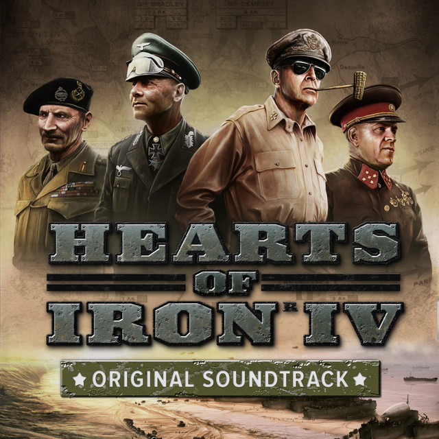

#     Hearts-of-Iron-IV-OST

A mod that adds the Hearts of Iron IV OST into Unciv

#     Installation

1. Load Unciv
2. Visit mods
3. Find and download "Hearts Of Iron IV OST"
4. Enable "Permanent audiovisual mod"

## Credits & Copyright

- **Music:** All tracks by Andreas Waldetoft.
- **Source:** Hearts of Iron IV Original Game Soundtrack
- **Tracks Used:** see `CREDITS.md` for the full track list.
- **Music copyright:** © Paradox Interactive AB. All rights reserved.

**Copyright notice:**

> Hearts of Iron IV © Paradox Interactive AB. www.paradoxplaza.com

All music is © Paradox Interactive AB. All rights reserved. The music was composed by Andreas Waldetoft.

The music files are included only as part of this mod for use with Unciv and are **not** covered by this repository’s code license. No ownership is claimed by the mod author over the music. The music is not intended for standalone redistribution or reuse outside this mod.

This mod is not affiliated with or endorsed by Paradox Interactive AB or this Unciv mod. 
